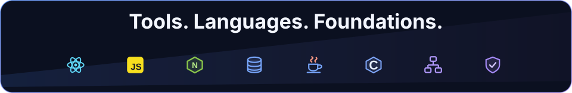
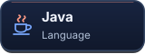
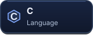
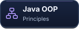
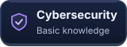

<!--
PROFILE README
Upload this README.md and the assets/ folder to your profile repository.
The repository name must match your current GitHub username.

CONTACT LINKS
At the bottom, replace the two placeholder URLs and uncomment the link block.
Only include public contact information you want displayed on your profile.
-->

  

<h1 align="center">Amine Kebab</h1>

  

  <a href="#about">About</a> ·
  <a href="#skills">Skills</a> ·
  <a href="#selected-work">Work</a> ·
  <a href="#current-focus">Focus</a> ·
  <a href="#collaboration">Collaborate</a>

## About

I'm **Amine Kebab**, also known as **amindev** — a full-stack developer with **six years of coding** across studies, personal projects, and client work.

I care about clear interfaces, simple design, and security awareness. My work brings together web development and computer science, with room to keep learning and collaborate.

## Skills

  <picture>
    <source media="(max-width: 600px)" srcset="./assets/skills-banner-mobile.svg" />
    
  </picture>

**Main web stack**

  
  
  
  

**Languages, principles, and security knowledge**

  
  
  
  

My cybersecurity knowledge is **basic**. **Computer architecture** is a current learning focus.

## Selected work

> ### 
> **Event website & event organization**
>
> **Context:** a computer science event connected to the **University of Béjaïa, Algeria**, bringing together event information and computer science content.
>
> **My contribution:** website development and participation in organizing the event.
>
> **What I focused on**
> - Presenting event and computer science information through a clear, simple interface.
> - Creating an engaging visual design.
> - Applying basic security checks to the website.
>
> **Work areas:** web design, web development, event organization, and security awareness.

> ### 
> **Learning & creator dashboard · Node.js + SQLite**
>
> **Purpose:** a dashboard for learning and creator activity, with a Node.js backend, JSON APIs, and SQLite persistence.
>
> **Implemented in the code**
> - **Accounts:** registration, sign-in, sign-out, and server-side sessions.
> - **Tasks:** per-user listings, completion toggles, and deletion.
> - **Drafts and preferences:** saving drafts, updating profile names, and choosing dashboard widget visibility.
> - **Data separation:** user-specific queries and persistent storage for accounts, sessions, tasks, and drafts.
>
> **Security features in the code:** scrypt password hashing, session cookies, CSRF checks, request validation, rate limiting, and parameterized SQL.
>
> **Frontend:** HTML, CSS, and JavaScript. The interface adapts an **Elzero Web School** course layout.
>
> **Prototype scope:** content areas such as courses, projects, friends, and files currently use demo views.

<!--
PROJECT LINKS
These projects are not yet published on GitHub.
Add their actual repository or demo links here when available.
-->

## Current focus

Currently learning more about:

- **Cybersecurity**
- **Computer architecture**

## Collaboration

I'm open to collaboration on **web development and computer science projects**.

<!--
PUBLIC CONTACT LINKS
Replace the placeholder URLs, then remove the comment markers around the
following line to display your links:

[LinkedIn](PASTE_YOUR_LINKEDIN_URL_HERE) · [Portfolio](PASTE_YOUR_PORTFOLIO_URL_HERE)
-->
