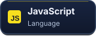

<!--
PROFILE README
Upload this README.md and the assets/ folder to your profile repository.
The repository name must match your current GitHub username.

CONTACT LINKS
At the bottom, replace the two placeholder URLs and uncomment the link block.
Only include public contact information you want displayed on your profile.
-->

  

<h1 align="center">Amine Kebab</h1>

  

  <a href="#about">About</a> ·
  <a href="#stack">Stack</a> ·
  <a href="#selected-work">Work</a> ·
  <a href="#current-focus">Focus</a> ·
  <a href="#collaboration">Collaborate</a>

## About

I'm **Amine Kebab**, also known as **amindev** — a full-stack developer with **six years of coding** across studies, personal projects, and client work.

I care about clear interfaces, simple design, and security awareness. My work brings together web development and computer science, with room to keep learning and collaborate.

## Stack

  
  
  
  

**Additional knowledge:** Java, including object-oriented programming, and C.

## Selected work

> ### Algomania
> **Event website & event organization**
>
> A computer science event connected to the **University of Béjaïa, Algeria**. I contributed to both the event website and the event's organization, with attention to clear design, simplicity, and basic security checks.

> ### Skillora
> **Learning & creator dashboard · Node.js + SQLite**
>
> A learning dashboard with account APIs and per-user tasks, drafts, and settings. Several content pages use demo data.
>
> The interface adapts an **Elzero Web School** course layout.

<!--
PROJECT LINKS
These projects are not yet published on GitHub.
Add their actual repository or demo links here when available.
-->

## Current focus

Currently learning more about:

- **Cybersecurity**
- **Computer architecture**

## Collaboration

I'm open to collaboration on **web development and computer science projects**.

<!--
PUBLIC CONTACT LINKS
Replace the placeholder URLs, then remove the comment markers around the
following line to display your links:

[LinkedIn](PASTE_YOUR_LINKEDIN_URL_HERE) · [Portfolio](PASTE_YOUR_PORTFOLIO_URL_HERE)
-->
